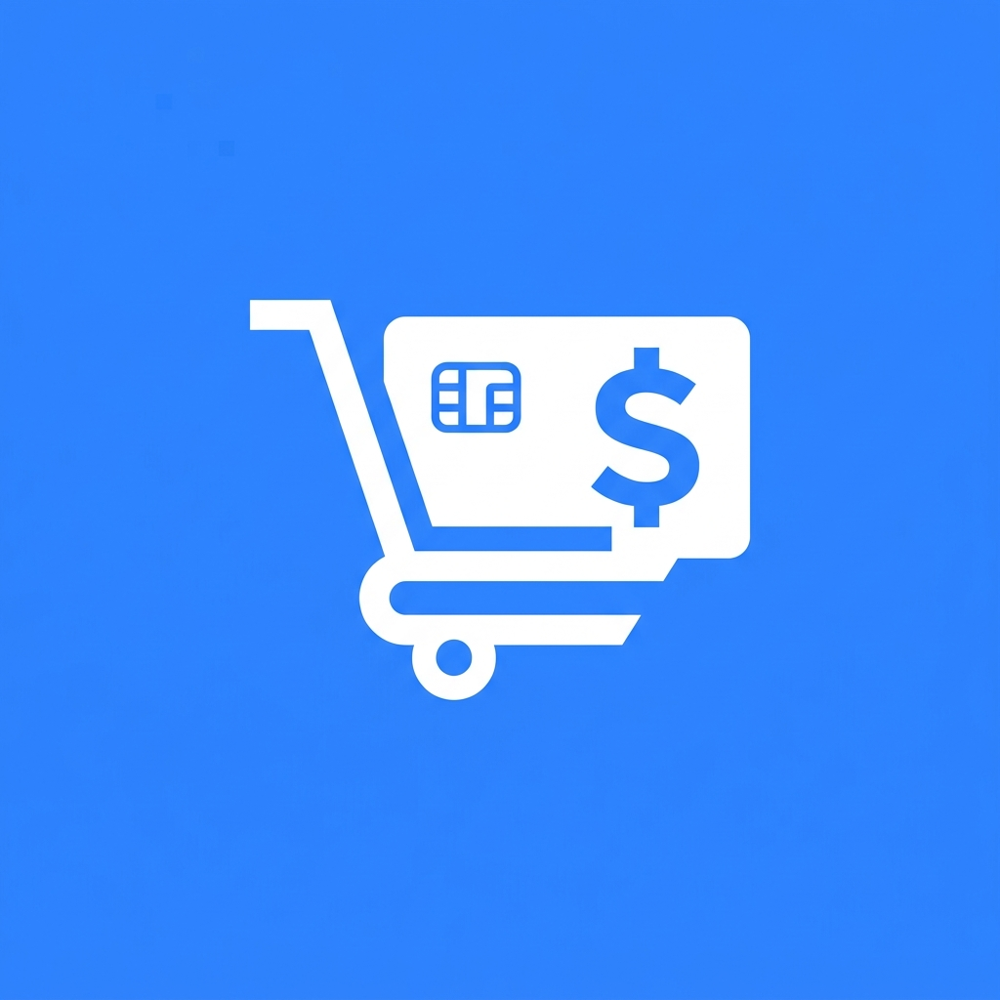
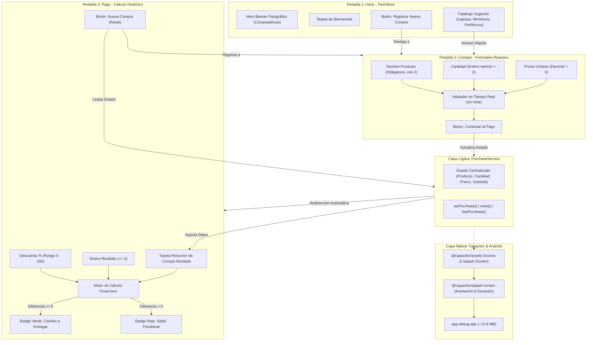

<div align="center">
  
  <h1>💳 APP-Pagos | Registro de Compra y Cálculo de Pago</h1>
  <p><em>Aplicación móvil híbrida de alto rendimiento desarrollada con Ionic Framework, Angular y Capacitor, con navegación por pestañas personalizadas, validaciones reactivas, catálogo tecnológico y motor de cálculo financiero en tiempo real.</em></p>

  <p>
    
    
    
    
    
    
  </p>
</div>

---

## 📖 Descripción del Proyecto

**APP-Pagos** es una solución móvil diseñada para optimizar el proceso de venta en comercios de tecnología y retail. Permite a los usuarios y cajeros registrar productos mediante formularios interactivos con validación estricta, aplicar descuentos porcentuales y determinar automáticamente si la transacción genera un cambio a favor del cliente o deja un saldo pendiente.

El flujo de usuario está distribuido en tres pestañas temáticas:
1. **Pestaña Inicio (`storefront-outline`):** Vitrina principal de bienvenida orientada a tecnología y computación. Cuenta con fotografía en alta resolución, presentación del sistema y catálogo de productos sugeridos (laptops, pantallas 4K, teclados mecánicos) con redirección rápida a compra.
2. **Pestaña Compra (`cart-outline`):** Módulo de captura de datos con validaciones reactivas en tiempo real para nombre del producto, cantidad entera y precio unitario. Al completar un registro válido, transfiere el estado al servicio central y navega automáticamente al módulo de pago.
3. **Pestaña Pago (`wallet-outline`):** Módulo de liquidación financiera que recibe el subtotal, permite ingresar un porcentaje de descuento (0 a 100%) y el dinero entregado. Calcula el total final y discrimina visualmente entre **Cambio a favor** (badge verde) y **Saldo pendiente** (badge rojo), permitiendo reiniciar el ciclo con el botón de "Nueva Compra".

---

## ✨ Características Principales

- 📱 **Navegación por Pestañas con Íconos Personalizados:** Cada vista cuenta con un ícono semántico propio de Ionicons (`storefront-outline`, `cart-outline`, `wallet-outline`) con soporte de estados activo/inactivo.
- 💻 **Showcase Tecnológico en Inicio:** Hero banner fotográfico de alta calidad (`tech-computers.jpg`) con overlay en gradiente, badge descriptivo y tarjetas de productos informáticos.
- 🔒 **Validaciones Reactivas Robustas:** Formularios implementados con `FormGroup` y `Validators` de Angular que impiden envíos inválidos y despliegan alertas contextuales en español.
- 💵 **Motor Matemático Financiero en Vivo:** Cálculo dinámico de subtotales, monto descontado, total final y balance inmediato (Cambio vs. Saldo Pendiente).
- 🎨 **Identidad Visual Neta con `@capacitor/assets`:** Ícono propio y Splash Screen corporativo adaptativo generados en todas las densidades de pantalla (`mdpi`, `hdpi`, `xhdpi`, `xxhdpi`, `xxxhdpi`).
- ⚡ **Desarrollo Multi-Agente & Eficiencia de Tokens:** Diseñado e implementado con un equipo de agentes especializados coordinados bajo las directrices de `drona23/claude-token-efficient` para un código limpio y sin redundancias.
- 🧪 **Cobertura de Pruebas Unitarias al 100%:** Suite de tests ejecutada con Vitest y JSDOM que certifica el correcto funcionamiento del servicio de compras y todos los componentes.

---

## 🏗️ Arquitectura del Sistema



---

## 🛠️ Tecnologías Usadas

### Frontend Móvil & Framework
- **Framework UI:** Ionic Framework v9.0.0
- **Lógica & Componentes:** Angular v22.1.7 (NgModules con formularios reactivos)
- **Lenguaje:** TypeScript v6.0.0
- **Iconografía:** Ionicons v8.1.0 (`storefront-outline`, `cart-outline`, `wallet-outline`, `laptop-outline`, etc.)
- **Estilos:** Sass / SCSS con paleta de colores Ionic (#3880ff) y temas adaptativos

### Capa Nativa & Compilación
- **Puente Nativo:** Capacitor v8.5.3
- **Generador de Recursos:** `@capacitor/assets`
- **Plugin de Carga:** `@capacitor/splash-screen` v8.0.2
- **Plataforma Nativa:** Android SDK (Build-Tools 35.0.0 / Platform 36)
- **Automatizador de Compilación:** Gradle v8.14.3 con Gradle Wrapper

### Testing & Calidad
- **Framework de Pruebas:** Vitest v4.0.18
- **Entorno DOM:** JSDOM v30.1.0
- **Metodología:** TDD para reglas financieras y ciclo de vida de componentes

---

## 🔒 Validaciones y Fórmulas Financieras

### Tabla de Reglas de Entrada

| Campo | Tipo | Validación Estricta | Mensaje de Error en Pantalla |
| :--- | :--- | :--- | :--- |
| **Nombre del Producto** | Texto | `Validators.required`, `minLength(2)` | *"El nombre del producto es obligatorio (mínimo 2 letras)."* |
| **Cantidad** | Entero | `Validators.required`, `min(1)`, `pattern('^[0-9]+$')` | *"La cantidad debe ser un número entero mayor a 0."* |
| **Precio Unitario** | Decimal | `Validators.required`, `min(0.01)` | *"El precio unitario debe ser mayor a 0."* |
| **Descuento (%)** | Numérico | `Validators.min(0)`, `Validators.max(100)` | *"El descuento debe estar entre 0% y 100%."* |
| **Dinero Recibido** | Decimal | `Validators.min(0)` | *"El dinero recibido no puede ser negativo."* |

### Fórmulas del Motor de Cálculo

$$\text{Subtotal} = \text{Cantidad} \times \text{Precio Unitario}$$

$$\text{Monto Descuento} = \text{Subtotal} \times \left(\frac{\text{Descuento \%}}{100}\right)$$

$$\text{Total Final} = \text{Subtotal} - \text{Monto Descuento}$$

$$\text{Diferencia} = \text{Dinero Recibido} - \text{Total Final}$$

- **Caso Cambio a Entregar ($\text{Diferencia} \ge 0$):**
  $$\text{Cambio} = \text{Diferencia} \quad \rightarrow \quad \text{\color{green}Badge Verde: Cambio: \$X.XX}$$
- **Caso Saldo Pendiente ($\text{Diferencia} < 0$):**
  $$\text{Saldo Pendiente} = \left| \text{Diferencia} \right| \quad \rightarrow \quad \text{\color{red}Badge Rojo: Saldo Pendiente: \$X.XX}$$

---

## 📸 Identidad Visual y Evidencias

### 1. Ícono Personalizado de la Aplicación
Diseño exclusivo que fusiona el color azul corporativo Ionic `#3880ff`, un carrito de compras digital, tarjeta de crédito y moneda, adaptado a todos los tamaños Android:

<p align="center">
  
</p>

### 2. Splash Screen Nativo
Pantalla de carga con fondo en degradado (#3880ff a #5260ff), logotipo central y tipografía corporativa para dispositivos móviles:

<p align="center">
  
</p>

### 3. Pantalla de Inicio (Pestaña Inicio - TechStore)
Banner publicitario de alta resolución que ilustra computadoras, portátiles y accesorios:

<p align="center">
  
</p>

---

## 🚀 Instalación y Despliegue Local

### 1. Clonar el Repositorio
```bash
git clone https://github.com/JimSul16/APP-Pagos.git
cd APP-Pagos
```

### 2. Instalar Dependencias
```bash
npm install
```

### 3. Ejecutar en Navegador (Modo Desarrollo Web)
```bash
npm start
# O bien utilizando Ionic CLI:
npx ionic serve
```
La aplicación se compilará y abrirá automáticamente en tu navegador en:
👉 `http://localhost:8100/tabs/tab1`

---

## 📦 Compilación y Generación del APK (Android)

El archivo ejecutable listo para instalar se encuentra compilado en la raíz del repositorio:
- **Archivo:** [`app-debug.apk`](./app-debug.apk) (o en `android/app/build/outputs/apk/debug/app-debug.apk`)
- **Tamaño:** ~13.8 MB

### Para recompilar el APK por Terminal:
```powershell
# 1. Compilar el código web de producción
npm run build

# 2. Sincronizar los cambios con la plataforma Android
npx cap sync android

# 3. Configurar el JDK de Android Studio y compilar
$env:JAVA_HOME = "D:\Android Studio\jbr"
cd android
.\gradlew assembleDebug
```

---

## 🧪 Testing y Calidad de Código

Para verificar la integridad de todos los módulos y la lógica del servicio de compras:

```bash
npm test
```

### Resultados de la Suite de Pruebas:
```text
 ✓  src/app/services/purchase.service.spec.ts (3 tests)
 ✓  src/app/app.component.spec.ts (1 test)
 ✓  src/app/tab1/tab1.page.spec.ts (1 test)
 ✓  src/app/tabs/tabs.page.spec.ts (1 test)
 ✓  src/app/explore-container/explore-container.component.spec.ts (1 test)
 ✓  src/app/tab2/tab2.page.spec.ts (1 test)
 ✓  src/app/tab3/tab3.page.spec.ts (1 test)

 Test Files  7 passed (7)
      Tests  9 passed (9)
```

---

## 🎥 Guía para la Verificación en Video / Capturas de Entrega

Para la verificación de entrega solicitada:
1. **Splash Screen e Ícono:**
   - Iniciar la app en el emulador o teléfono para capturar la animación del Splash Screen azul con el logotipo.
   - Ir al cajón de aplicaciones del teléfono para evidenciar el ícono personalizado con bordes adaptativos.
2. **Pestaña Inicio:**
   - Mostrar la fotografía de computadoras, el banner y el catálogo de productos informáticos sugeridos.
3. **Pestaña Compra (Validaciones):**
   - Intentar enviar campos vacíos o con números negativos para mostrar las advertencias en color rojo.
   - Ingresar datos válidos (ej. *"Laptop Gamer RTX"*, Cantidad: `2`, Precio: `1250.00`) y pulsar *"Continuar al Pago"*, evidenciando la navegación automática a la pestaña Pago.
4. **Pestaña Pago (Cálculos):**
   - Verificar el subtotal recibido ($2500.00).
   - Aplicar descuento del 10% (Total: $2250.00).
   - Ingresar $2000.00 $\rightarrow$ Muestra chip rojo: **Saldo Pendiente: $250.00**.
   - Ingresar $2500.00 $\rightarrow$ Muestra chip verde: **Cambio: $250.00**.
   - Presionar *"Nueva Compra"* y comprobar que los datos se resetean y regresa a Compra.

---

<div align="center">
  <i>Desarrollado para la materia de Aplicaciones Móviles 2026-B</i>
</div>
